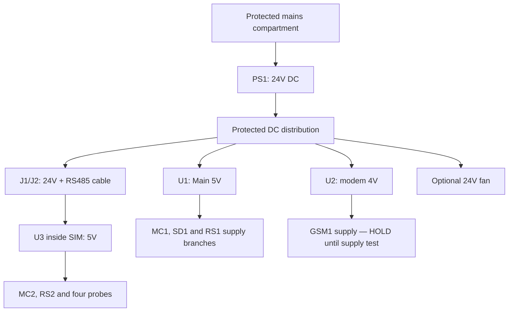
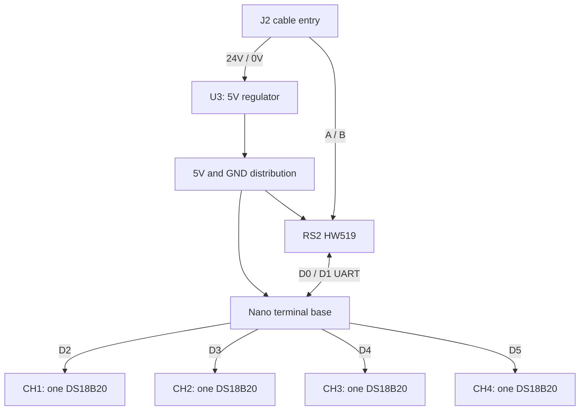

# BIO-EMS — Main + SIM-D4 wiring and mounting reference

## 26 October test usage

This Rev B terminal schedule remains an engineering draft. Initial isolated USB tests require different QC pin use and disconnection of interfering peripherals. Restore Main pilot.7 and Nano bench.2 before the integrated path; do not extend isolated USB power approval to the complete assembly. The current checkpoint defines the staged test and evidence limits.

See [26 October checkpoint](../current/PROJECT-CHECKPOINT-2026-10-26.md).
Date: 2026-10-20 • Revision B • Status: ENGINEERING DRAFT — NOT RELEASED FOR ENERGISING

## Scope and release status
One ESP32-S3 Main, one Nano SIM-D4, four independent DS18B20 channels. Power supply inside Main; GSM is SIM800L 2G with external antenna. Supersedes all generated photorealistic wiring pictures in the discussion.

This document contains exact named-terminal schedules for the supported bench interfaces, with conditional and held circuits explicitly identified. It is NOT a fully qualified assembly reference. No physical measurements, continuity check, or energisation test was performed. Host protocol/calendar/offline-queue tests and a full ESP-IDF v5.5.5 ESP32-S3 build passed; CI is tracked in PR #304. No dimensional drilling template is supplied.

Firmware target: 0.1.0-pilot.7. RS485/SD/Ethernet pin assignments are retained; DS3231 UTC restore and explicit SIM800L bench commands are now implemented. This is still a bench engineering reference: code tests do not certify the actual assembly. Autonomous SMS alarm/fallback policy is NOT implemented. Source and drawings must be reviewed together.

## Identification
PS1 = existing S-72-24, 24V/3A supply.
U1 = LM2596, Main regulated 5V.
U2 = XL4015, modem regulated 4V.
U3 = LM2596, SIM regulated 5V.
MC1 = ESP32-S3 in its 44-pin terminal base.
MC2 = classic Nano V3 in its terminal base.
RS1/RS2 = Main/SIM HW519.
LS1 = selected four-channel LV/HV MOSFET logic converter, NOT the earlier TXI/RXI version.
SD1 = HW125 microSD module.
GSM1 = red SIM800L breakout.
RTC1 = DS3231 module.
J1/J2 = DESIGNATED four-way Main/SIM cable termination points; these are proposed labels, not markings on an existing connector.

All schedules use terminal NAMES, not left/right positions. Read board printing. Never infer pin order from a flipped photograph.

## 1. Power topology
This diagram shows distribution, not wire ratings or a mains construction drawing.

### DC wire schedule
Do not connect loads until regulator polarity/output is measured. Final branch protection, wire sizes and connector current ratings remain to be selected for actual cable lengths/loads. Never use Dupont/breadboard contacts for modem supply or mains.

| Wire | From | To | Design colour | Status |
|---|---|---|---|---|
| P01 | PS1 +V, protected branch | U1 IN+ | Red, labelled 24V | Planned |
| P02 | PS1 -V | U1 IN- | Black, labelled 0V | Planned |
| P03 | PS1 +V, protected branch | U2 IN+ | Red, 24V | Planned |
| P04 | PS1 -V | U2 IN- | Black, 0V | Planned |
| P05 | U1 OUT+ after 5.00V check | MC1 terminal labelled 5V | Red, labelled 5V | Conditional on base mapping; USB disconnected |
| P06 | U1 OUT- | MC1 GND and low-voltage ground distribution | Black | Planned |
| P07 | U1 5V distribution | SD1 VCC | Red, 5V | Supplier specifies 4.5–5.5V input |
| P08 | Low-voltage ground | SD1 GND | Black | Planned |
| P09 | U1 5V distribution | RS1 VCC | Red, 5V | Conditional on actual HW519 verification |
| P10 | Low-voltage ground | RS1 GND, TTL side | Black | Planned |
| P11 | U2 OUT+ after 4.00V check | GSM1 VCC | Red, labelled 4V | HOLD pending transient/load test and secure terminations |
| P12 | U2 OUT- | GSM1 GND | Black | Same HOLD |
| P13 | Modem 4V | C1 positive, 1000uF/10V Low ESR | Short local connection | Pending part; support capacitance, not substitute for adequate supply |
| P14 | Modem GND | C1 negative/striped terminal | Short local connection | Pending |
| P21 | Modem 4V | C2 100nF ceramic, one end | Short local connection | Confirm part |
| P22 | Modem GND | C2 other end | Short local connection | Confirm part |
| P15 | PS1 +V, separately protected branch | J1 terminal 1 | Red, 24V | Planned |
| P16 | PS1 -V | J1 terminal 2 | Black, 0V | Planned |
| P17 | J2 terminal 1 | U3 IN+ | Red, 24V | Planned |
| P18 | J2 terminal 2 | U3 IN- | Black, 0V | Planned |
| P19 | U3 OUT+ after 5.00V check | MC2 5V, RS2 VCC, probe 5V distribution | Red, 5V | Do not use Nano VIN for this regulated 5V input |
| P20 | U3 OUT- | MC2 GND, RS2 TTL-side GND, probe GND distribution | Black | Planned |

Separate branch labels distinguish red 24V, 5V and 4V wires. The non-isolated buck converters normally share 0V; verify continuity on actual hardware. Protective earth is a separate function, not a replacement for the signal/power return.

USB: disconnect external board power during initial USB flashing/tests unless the exact board's power-selection arrangement has been verified. Disconnect Nano D0/D1 RS485 connections during flashing.

## 2. Main to SIM: ONE cable, four conductors
| Design terminal | Function | Main end | SIM end |
|---|---|---|---|
| 1 | +24V | Protected DC branch | U3 IN+ |
| 2 | 0V | PS1 -V/common DC return | U3 IN- and common reference |
| 3 | RS485 A | RS1 A+ | RS2 A+ |
| 4 | RS485 B | RS1 B- | RS2 B- |

Use a twisted pair for A/B. Select power conductor size for measured load, length and voltage drop; these have not been supplied. No RJ45 pin numbering is approved by this table. Shield and protective-earth treatment require a separate installation decision.

HW519 bus-side terminal marked earth is NOT assigned to DC 0V here. Leave that terminal unconnected in the draft until the protection circuit/continuity is established. Do not infer galvanic isolation from the separate terminal.

Check termination with power off before adding resistors. Two physical bus ends need appropriate termination; establish which onboard links/resistors are actually populated. Do not add a second 120-ohm resistor in parallel to an existing one. Intermediate nodes in future expansion must not all be terminated.

## 3. Main RS485 UART — conditional LS1 interface
Verified controller source: GPIO17 TX, GPIO18 RX, UART1, 9600 8N1; automatic direction, no DE/RE.

| Wire | From | To |
|---|---|---|
| R01 | MC1 3V3 | LS1 LV |
| R02 | Main 5V | LS1 HV |
| R03 | Common signal GND | LS1 GND |
| R04 | MC1 GPIO17 TX | LS1 LV1 |
| R05 | LS1 HV1 | RS1 RXD (per repository interface convention) |
| R06 | RS1 TXD | LS1 HV2 |
| R07 | LS1 LV2 | MC1 GPIO18 RX |

LV3/HV3 and LV4/HV4 remain unused. These pairings assume the selected symmetric four-channel MOSFET converter; do not apply to the TXI/RXI board. Actual HW519 data direction and output level must be checked before MC1 is attached. Bench-test LS1 at 9600 baud using short wires. Adding LS1 does not resolve an unidentified HW519 output circuit or prove signal margins.

## 4. Main SD and Ethernet
SD uses SPI3; Ethernet uses SPI2. Do not share their pin schedules.

| Wire | MC1 | SD1 |
|---|---|---|
| S01 | GPIO4 | MOSI |
| S02 | GPIO5 | MISO |
| S03 | GPIO6 | SCK |
| S04 | GPIO7 | CS |

SD power is P07/P08. Supplier lists onboard 3.3V regulator and 3.3/5V logic compatibility. Verify actual MISO never drives 5V before attaching to ESP32. Keep SPI leads short; the UART MOSFET converter is not approved as an SD/SPI adapter.

| Wire | MC1 | Future W5500 terminal |
|---|---|---|
| E01 | GPIO11 | MOSI |
| E02 | GPIO13 | MISO |
| E03 | GPIO12 | SCLK/SCK |
| E04 | GPIO10 | CS/SCS |
| E05 | GND | GND |

W5500 power input remains HOLD until the exact purchased breakout is identified: do not assume every W5500 board accepts 5V. Current driver polls (INT not used) and does not drive reset; confirm breakout has correct reset/pullup arrangement. Unused INT must not be tied arbitrarily.

## 5. SIM-D4 complete sensor-channel schedule

The arrows to sensors indicate DATA only. Each sensor ALSO receives regulated 5V and GND as scheduled below.

| Wire | From | To |
|---|---|---|
| N01 | MC2 D1/TX | RS2 RXD, per repository convention |
| N02 | RS2 TXD | MC2 D0/RX |
| C01 | MC2 D2 | CH1 DATA |
| C02 | MC2 D3 | CH2 DATA |
| C03 | MC2 D4 | CH3 DATA |
| C04 | MC2 D5 | CH4 DATA |
| C05–C08 | Probe 5V distribution | CH1–CH4 VDD, one branch each |
| C09–C12 | Probe GND distribution | CH1–CH4 GND, one branch each |
| C13 | CH1 DATA | R1 one end |
| C14 | R1 other end | Regulated 5V |
| C15 | CH2 DATA | R2 one end |
| C16 | R2 other end | Regulated 5V |
| C17 | CH3 DATA | R3 one end |
| C18 | R3 other end | Regulated 5V |
| C19 | CH4 DATA | R4 one end |
| C20 | R4 other end | Regulated 5V |

R1–R4 are each 4.7k ohm, not one common resistor for all channels. One probe per channel. No parasitic-power configuration. Red/black/yellow probe colours are not sufficient proof of pin function: confirm the supplied cable mapping.

For the first SIM (address 1), leave Nano D7/D8 floating as defined by firmware; D6 unused. Do not connect D7/D8 to 5V. Other address combinations are outside this initial one-SIM build.

## 6. RTC and 2G modem — implemented bench interfaces
### DS3231
| Wire | From | To |
|---|---|---|
| T01 | MC1 3V3 | RTC1 VCC |
| T02 | Common GND | RTC1 GND |
| T03 | MC1 GPIO8 | RTC1 SDA |
| T04 | MC1 GPIO9 | RTC1 SCL |

SQW and 32K unused. I2C 100 kHz, address 0x68. Confirm both bus pullups go to 3.3V; add external 4.7k pullups to 3.3V only if absent. Battery type must match the module charging circuit. Do not install a CR2032 into an active charger.

The driver checks OSF, BCD, calendar and supported date range. A persisted commissioning marker is invalidated before writing the RTC and restored only after successful readback/OSF clearing. Fresh USB `settime <UTC epoch>` or authenticated server time commissions it. A prior NVS epoch alone never makes queued timestamps trusted. On reboot a commissioned, readable RTC with OSF clear restores UTC trust. This is operational validity, not tamper-resistant time authentication.

### SIM800L UART — separate from LS1
Do NOT use LS1 HV=5V for the modem. The module UART has lower voltage limits. Add two 1% resistors (1k and 5.6k); use the existing 2N2222A and three 4.7k resistors for the receiver. No physical transistor leg order is assumed.

| Wire | From | To |
|---|---|---|
| G01 | MC1 GPIO14 TX | R5 1k, 1%, input end |
| G02 | R5 output end | GSM1 RXD and R6 top |
| G03 | R6 5.6k, 1%, bottom | Common GND |
| G04 | GSM1 TXD | R7 4.7k input end |
| G05 | R7 output end | Q1 BASE and R8 top |
| G06 | R8 4.7k bottom | Common GND |
| G07 | Q1 EMITTER | Common GND |
| G08 | Q1 COLLECTOR | MC1 GPIO21 RX and R9 bottom |
| G09 | R9 4.7k top | MC1 3V3 |

Q1 = 2N2222A, verify manufacturer E/B/C before fitting. G02 nominal ~2.80V; 1% resistor tolerances give divider ratio ~0.846 to 0.851. At 3.6V TX high the node is <3.07V; at 2.64V TX high >2.23V. Require the ESP 3V3 rail to remain 3.2–3.4V under load; at 3.2V supply and an 0.8*VDD GPIO high, the divider node remains above 2.16V. These calculations cover static levels, not board-level waveform validation. Q1 restores the low modem TX high level to an ESP 3.3V signal and INVERTS it. Firmware MUST retain `BIOEMS_GSM_RX_INVERTED=y`; a direct wire would be the wrong interface. Keep logic runs short; verify idle and 9600-baud waveforms on the actual unit.

U2 supplies modem VCC at 4.00V, NOT 5V. C1 1000uF/10V Low ESR goes directly across GSM1 VCC/GND (positive to VCC). Add local 100nF ceramic across the same rails. Use secure short supply leads, no Dupont contacts for burst current. Verify 2A burst capability and voltage at the module remains within 3.4–4.4V. A capacitor does not compensate for a bad supply. U2/module must share the signal ground; prevent UART driving an unpowered modem during commissioning. Only connect the logic after both rails are stable, power off for wiring changes.

RST, DTR, RING and audio terminals remain unconnected in this awake bench profile. Confirm the exact breakout starts from its power circuit; no PWRKEY/reset control has been added. If it does not auto-start, stop and identify its startup circuit rather than applying an arbitrary voltage to RST.

Antenna: external GSM 850/900/1800/1900MHz antenna, 50-ohm matching RF cable and bulkhead. Confirm miniature connector type on the real PCB. Use ONE intended antenna path; do not connect the spring antenna and external path simultaneously without checking board RF routing. NET pad is not general ground. Actual 2G registration is a commissioning test, not guaranteed by the drawing.

Commands at the existing USB console: `rtc`, `gsmdiag`, `gsmtest +<country-number>`. The last sends one real fixed English bench SMS; it can cost credit. Success means accepted by modem/network, not delivery. Ambiguous submissions are not automatically retried. No recipient is stored and no unattended SMS is generated.

## 7. Box installation plan
MAIN: PS1 inside separated mains compartment; insulated fixed barrier and covered mains terminals remain finger-safe when electronics compartment is open. Mains inlet, fuse, switch, protective earth and wire/clearance selection are for a qualified electrician based on actual PS1 ratings and enclosure. No mains wiring on solderless breadboard. This document does not supply an approved mains termination schedule.
Low-voltage mounting plate holds MC1 base, RS1, LS1, SD1, RTC1, U1/U2 and GSM1. Keep ESP32 PCB antenna clear. External GSM antenna on outer wall with short RF route away from power converter wiring.
Optional 24V fan: guarded, filtered airflow; separately protected 24V branch, no GPIO supply. Fan size/current/protection and thermal need remain to be selected/tested. Vent openings change ingress protection.
SIM: MC2 terminal base, U3 near cable entry, RS2 near A/B pair, four labelled sensor exits, pullups and Q1 interface on securely terminated insulated carriers. No independent 230V input, no mains PSU, no modem in SIM.
Use nylon standoffs sized to actual holes (not universally M3). Secure cable glands and internal strain relief. Modules lacking mounting holes need insulated carriers. Unpopulated electrical pads need secure supplier-fitted headers/leads; loose wires in PCB holes are not accepted.
Final box sizes and drilling positions require actual expansion-base dimensions and safe clearances. No dimensions inferred from product photos.

## 8. Release checklist
- Confirm actual part identities, terminal base continuity and all terminal labels.
- Select AC/DC protective devices, wire sizes and connector ratings.
- Measure regulator outputs with loads disconnected; test under representative loads.
- Verify HW519 levels/direction, LS1 waveform margins, common reference and termination.
- Confirm sensor wire mapping and separate pullups; flash correct Nano image.
- Test individual channels, RS485 scan, SD read/write and Ethernet when acquired.
- Build matching pilot.7 firmware; run `rtc`, cold boot battery restore, `gsmdiag` and explicit `gsmtest` on actual hardware.
- Validate GSM UART matching and 4V burst supply; external antenna and SIM registration.
- Inspect continuity/polarity/shorts and isolation before any energisation; record measured results.
- Do not connect external 5V board power and USB concurrently until power-path behaviour is verified.

## Sources and provenance
Repository sources reviewed:
- firmware/site-controller-esp32s3/main/main.c
- firmware/site-controller-esp32s3/main/CMakeLists.txt
- firmware/site-controller-esp32s3/main/sim_modbus.c
- firmware/site-controller-esp32s3/main/Kconfig.projbuild
- firmware/site-controller-esp32s3/main/ethernet.c
- firmware/sim-d4-nano/README.md (previously reviewed in this session)
Supplier:
- https://makerselectronics.com/product/hw-519-ttl-to-rs485-converter-module/ (internally inconsistent logic/supply description; not a schematic)
- https://makerselectronics.com/product/micro-sd-card-reader-module/ (5V design input based on detailed 4.5–5.5V specification; summary differs)
- https://makerselectronics.com/product/sim800l-gsm-gprs-module-antenna/
Manufacturer-authored guide:
- SIMCom SIM800H&SIM800L Hardware Design V2.02, 2015-07-27, tables 10 and 44; https://www.laskakit.cz/user/related_files/sim800l_v2_1.pdf

The generated product pictures are not source evidence and are explicitly superseded.

## 9. Quantities and purchase completion (one Main + one SIM)
- 1 ESP32-S3 N16R8 + matching 44-pin terminal base; 1 Nano V3 + terminal base (second Nano spare).
- 2 HW519 (third spare), 1 four-channel symmetric LV/HV converter for Main RS485 only.
- 2 LM2596 total (Main 5V, SIM 5V), 1 XL4015 total (modem 4V). Supplier must fit secure terminations.
- 4 DS18B20 probes, four independent 4.7k sensor pullups.
- 1 HW125 SD module + compatible microSD, 1 DS3231 + confirmed compatible battery arrangement.
- 1 SIM800L + active SIM/2G service + external antenna/RF cable, 1 Q1 2N2222A (of 10 available).
- 3 additional 4.7k for Q1 circuit; 1x1k 1% and 1x5.6k 1% for TX divider. Optional RTC pullups 2x4.7k only if absent.
- 1x1000uF/10V Low ESR + 1x100nF local modem decoupling; confirm actual ceramic marking.
- W5500 future purchase: exact breakout identification required before connecting power.
- 1 PS1 24V/3A; optional 24V fan. Two enclosures, insulated mounting plates/barrier, glands, screw terminals and strain relief. Protective devices, conductor sizes and box dimensions depend on measured loads/lengths and electrician selection.

## 10. Reproducible drawings
See `wiring-reference/` SVG sheets and generator. Drawings are named-terminal electrical schedules, not scaled photographs or a transistor footprint. The power drawing stops at protected 24V DC; mains installation is explicitly outside its construction approval. Outstanding hardware checks above remain mandatory before energising.
